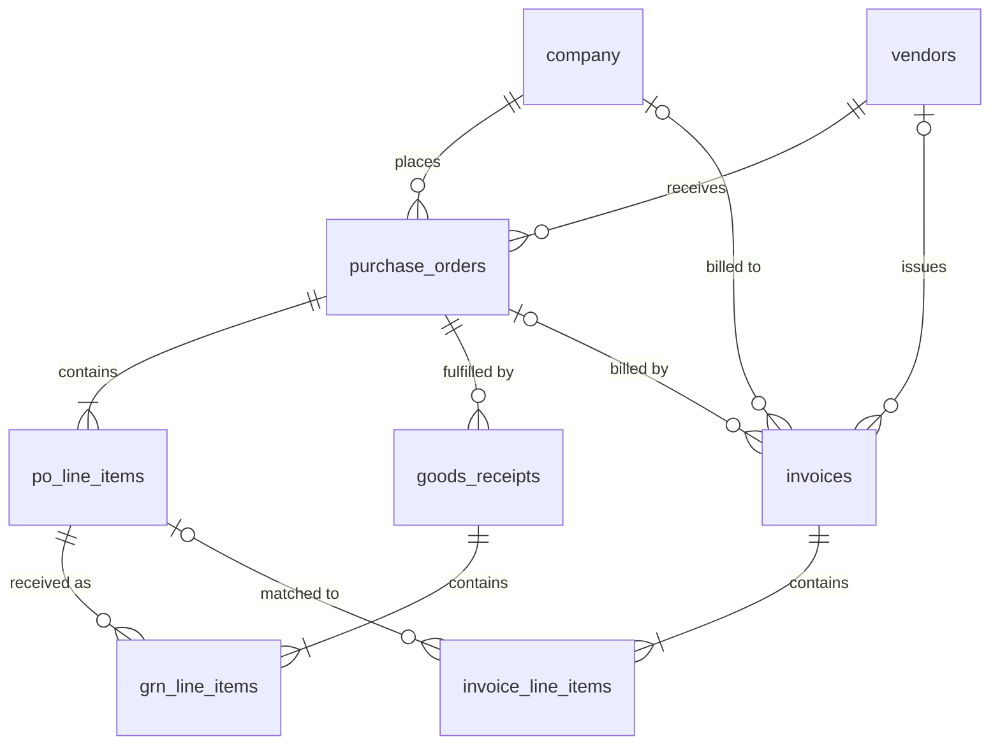

# Phase 1: Database Schema (v2)

Status: **agreed**. The open questions from v1 are resolved; see [Decisions](#decisions) at the bottom.

---

## 1. Design Principles

1. **Money is never a float.** All amounts are `NUMERIC(14,2)`; quantities are `NUMERIC(14,3)` (allows kg, litres, metres); GST rates are `NUMERIC(5,2)`.
2. **Master data is strict, invoice data is loose.** `vendors`, `purchase_orders`, and `goods_receipts` are our own trusted records, so they get tight constraints (GSTIN format, IFSC format, NOT NULLs). `invoices` hold whatever the vendor *claimed*, possibly wrong or malicious, so most columns are nullable and unconstrained. Validation (Phase 4) is what flags bad values, not the database rejecting the insert.
3. **Store what the invoice says, not what it should say.** Invoice header totals (`subtotal`, `cgst`, `total`, …) are stored as printed, even if they don't add up. That's how Phase 4 catches arithmetic errors.
4. **Derive, don't duplicate, on our own records.** PO totals are computed from `po_line_items` (via a view), not stored, so they can't drift.
5. **Duplicates must be insertable.** There is *no* unique constraint on `(vendor_id, invoice_number)`: a duplicate invoice has to be saved so it can be escalated. We use a normal index for fast lookup instead.
6. **Enums as `TEXT` + `CHECK`**, not Postgres `ENUM` types. Adding a status later is a one-line migration instead of an `ALTER TYPE` dance.
7. **IDs are `BIGINT GENERATED ALWAYS AS IDENTITY`.** Business identifiers (`po_number`, `grn_number`) are separate unique columns.
8. **Every table has `created_at` / `updated_at` (`TIMESTAMPTZ`, default `now()`).** Omitted from the tables below for brevity.
9. **Only build what Phase 1 needs.** Email columns (Phase 8), posting columns (Phase 10), and so on get added by their own migrations later.

---

## 2. Entity Relationship Overview



`|o` = optional: an invoice may reference an unknown vendor, an unknown branch GSTIN, or no PO, which are exactly the cases we need to detect.

---

## 3. Tables

### 3.1 `company` (new, not in PHASES.md)

The buyer, i.e. *us*. Needed because intra-state vs inter-state GST is decided by comparing the **vendor's state** with the **buyer's state / place of supply**. Without this, Phase 4's CGST/SGST vs IGST rule has nothing to compare against.

**One row per GST registration (branch).** Under GST, each state a company operates in has its own GSTIN, so each branch is its own row. POs are raised by a branch, and invoices are billed to one.

| Column | Type | Constraints | Notes |
|---|---|---|---|
| `id` | BIGINT | PK | |
| `name` | TEXT | NOT NULL | e.g. "Kaveri Manufacturing Pvt Ltd – Chennai" |
| `gstin` | CHAR(15) | NOT NULL, UNIQUE, format CHECK | |
| `state_code` | CHAR(2) | NOT NULL | GST state code, e.g. `33` = Tamil Nadu. Must equal `LEFT(gstin, 2)` (CHECK) |
| `address` | TEXT | | |

---

### 3.2 `vendors`

| Column | Type | Constraints | Notes |
|---|---|---|---|
| `id` | BIGINT | PK | |
| `name` | TEXT | NOT NULL | Trade name, e.g. "Sharma Traders" |
| `legal_name` | TEXT | | As registered under GST |
| `gstin` | CHAR(15) | UNIQUE, format CHECK, nullable | Nullable for unregistered (composition / small) vendors |
| `pan` | CHAR(10) | | Characters 3–12 of the GSTIN |
| `state_code` | CHAR(2) | NOT NULL | Must equal `LEFT(gstin, 2)` when GSTIN is present (CHECK) |
| `address` | TEXT | | |
| `email` | TEXT | | Used later to match inbound email senders (Phase 8) |
| `phone` | TEXT | | |
| `bank_account_name` | TEXT | NOT NULL | |
| `bank_account_number` | TEXT | NOT NULL | TEXT, not a number: leading zeros matter |
| `bank_ifsc` | CHAR(11) | NOT NULL, CHECK `^[A-Z]{4}0[A-Z0-9]{6}$` | |
| `bank_name` | TEXT | | |
| `payment_terms_days` | INT | NOT NULL, default 30 | Useful for "what do we owe" / overdue questions (Phase 13) |
| `is_active` | BOOLEAN | NOT NULL, default true | |

**Indexes:** `UNIQUE(gstin)`, `lower(name)` for fuzzy vendor lookup.

GSTIN format CHECK: `^[0-9]{2}[A-Z]{5}[0-9]{4}[A-Z][1-9A-Z]Z[0-9A-Z]$`. The **checksum** is validated in Python (Phase 4), and the seed script generates GSTINs with correct checksums.

---

### 3.3 `purchase_orders`

| Column | Type | Constraints | Notes |
|---|---|---|---|
| `id` | BIGINT | PK | |
| `po_number` | TEXT | NOT NULL, UNIQUE | e.g. `PO-2026-0042` |
| `vendor_id` | BIGINT | NOT NULL, FK → vendors | |
| `company_id` | BIGINT | NOT NULL, FK → company | |
| `po_date` | DATE | NOT NULL | |
| `expected_delivery_date` | DATE | | |
| `place_of_supply_state_code` | CHAR(2) | NOT NULL | Usually the company's state; can differ if delivered to another branch |
| `currency` | CHAR(3) | NOT NULL, default `'INR'` | |
| `status` | TEXT | NOT NULL, CHECK in (`open`, `partially_received`, `received`, `closed`, `cancelled`) | |
| `notes` | TEXT | | |

**Indexes:** `vendor_id`, `status`.

**View `purchase_order_totals`:** `po_id, subtotal, tax_total, total`, computed from line items.

---

### 3.4 `po_line_items`

| Column | Type | Constraints | Notes |
|---|---|---|---|
| `id` | BIGINT | PK | |
| `po_id` | BIGINT | NOT NULL, FK → purchase_orders ON DELETE CASCADE | |
| `line_number` | INT | NOT NULL | UNIQUE with `po_id` |
| `description` | TEXT | NOT NULL | |
| `hsn_sac` | VARCHAR(8) | NOT NULL, CHECK digits only, length 4–8 | HSN for goods, SAC for services |
| `quantity` | NUMERIC(14,3) | NOT NULL, CHECK > 0 | |
| `unit` | TEXT | NOT NULL | `NOS`, `KGS`, `MTR`, `LTR`, … (GST UQC codes) |
| `unit_price` | NUMERIC(14,2) | NOT NULL, CHECK ≥ 0 | Pre-tax |
| `gst_rate` | NUMERIC(5,2) | NOT NULL, CHECK in (0, 0.25, 1.5, 3, 5, 12, 18, 28, 40) | Percent. Pre- and post-GST 2.0 (Sept 2025) slabs, so older documents still fit |

Line amount (`quantity × unit_price`) is computed, not stored.

---

### 3.5 `goods_receipts`

| Column | Type | Constraints | Notes |
|---|---|---|---|
| `id` | BIGINT | PK | |
| `grn_number` | TEXT | NOT NULL, UNIQUE | e.g. `GRN-2026-0107` |
| `po_id` | BIGINT | NOT NULL, FK → purchase_orders | |
| `received_date` | DATE | NOT NULL | |
| `received_by` | TEXT | | Store-keeper name |
| `vendor_challan_number` | TEXT | | Delivery challan ref; common on Indian GRNs |
| `notes` | TEXT | | |

A PO can have **many** GRNs (partial deliveries).

---

### 3.6 `grn_line_items`

| Column | Type | Constraints | Notes |
|---|---|---|---|
| `id` | BIGINT | PK | |
| `grn_id` | BIGINT | NOT NULL, FK → goods_receipts ON DELETE CASCADE | |
| `po_line_item_id` | BIGINT | NOT NULL, FK → po_line_items | Links receipt to what was ordered |
| `quantity_received` | NUMERIC(14,3) | NOT NULL, CHECK ≥ 0 | |
| `quantity_rejected` | NUMERIC(14,3) | NOT NULL, default 0, CHECK 0 ≤ x ≤ received | Damaged / failed QC |

Accepted quantity = `received − rejected`. The three-way match (Phase 5) checks **invoiced ≤ total accepted across all GRNs for that PO line**.

**View `po_line_receipt_summary`:** `po_line_item_id, ordered_qty, accepted_qty, invoiced_qty`. This one view does most of Phase 5's heavy lifting.

---

### 3.7 `invoices`

Created in Phase 1, but mostly written by Phases 3–7. The seed only inserts **historical** invoices (see §4).

| Column | Type | Constraints | Notes |
|---|---|---|---|
| `id` | BIGINT | PK | |
| `vendor_id` | BIGINT | FK → vendors, **nullable** | NULL = vendor not found in master (fraud signal) |
| `company_id` | BIGINT | FK → company, **nullable** | Branch billed, resolved from `buyer_gstin_on_invoice`. NULL = GSTIN matches none of our branches |
| `po_id` | BIGINT | FK → purchase_orders, **nullable** | Resolved during matching |
| `status` | TEXT | NOT NULL, CHECK, see below | |
| **As printed on invoice** | | | |
| `invoice_number` | TEXT | | |
| `invoice_date` | DATE | | |
| `po_number_on_invoice` | TEXT | | Raw reference; may not exist in our DB |
| `vendor_name_on_invoice` | TEXT | | |
| `vendor_gstin_on_invoice` | TEXT | | TEXT, not CHAR(15): might be malformed |
| `buyer_gstin_on_invoice` | TEXT | | Should equal our company GSTIN |
| `place_of_supply_state_code` | TEXT | | |
| `currency` | CHAR(3) | default `'INR'` | |
| `subtotal` | NUMERIC(14,2) | | Taxable value as printed |
| `cgst_amount` | NUMERIC(14,2) | | |
| `sgst_amount` | NUMERIC(14,2) | | |
| `igst_amount` | NUMERIC(14,2) | | |
| `cess_amount` | NUMERIC(14,2) | | Rare, but exists (e.g. tobacco, vehicles) |
| `round_off` | NUMERIC(14,2) | | Indian invoices often round to the rupee |
| `total_amount` | NUMERIC(14,2) | | Grand total as printed |
| `bank_account_name` | TEXT | | Compared with vendor master (fraud check) |
| `bank_account_number` | TEXT | | |
| `bank_ifsc` | TEXT | | |
| **Source & pipeline** | | | |
| `source_type` | TEXT | NOT NULL, CHECK in (`file`, `email`, `seed`) | |
| `source_file_path` | TEXT | | |
| `file_sha256` | CHAR(64) | | Catches the *exact same file* sent twice |
| `extraction` | JSONB | | Full extracted payload incl. per-field evidence (Phase 3) |
| `validation_results` | JSONB | | List of `ValidationResult` (Phase 4) |
| `match_result` | JSONB | | `MatchResult` (Phase 5) |
| `decision` | TEXT | CHECK in (`approve`, `vendor_query`, `escalate`) | Phase 6 |
| `decision_reasons` | JSONB | | Human-readable reasons (array of strings) |
| `workflow_thread_id` | TEXT | UNIQUE | LangGraph thread ID (Phase 7) |
| `approved_by` | TEXT | | |
| `approved_at` | TIMESTAMPTZ | | |
| `due_date` | DATE | | `invoice_date + vendor.payment_terms_days` |
| `paid_at` | TIMESTAMPTZ | | NULL = unpaid; powers "what do we owe X?" |

**Status values:** `received`, `extracting`, `extracted`, `validating`, `awaiting_approval`, `query_sent`, `escalated`, `approved`, `rejected`, `posted`, `paid`, `failed`.

**Indexes:**
- `(vendor_id, lower(invoice_number))`, **not unique**, for duplicate detection
- `(vendor_id, total_amount, invoice_date)` for "same amount, same date" duplicates
- `file_sha256`
- `status`
- `company_id`
- `po_id`

---

### 3.8 `invoice_line_items`

| Column | Type | Constraints | Notes |
|---|---|---|---|
| `id` | BIGINT | PK | |
| `invoice_id` | BIGINT | NOT NULL, FK → invoices ON DELETE CASCADE | |
| `line_number` | INT | NOT NULL | UNIQUE with `invoice_id` |
| `description` | TEXT | | |
| `hsn_sac` | TEXT | | Loose: as printed |
| `quantity` | NUMERIC(14,3) | | |
| `unit` | TEXT | | |
| `unit_price` | NUMERIC(14,2) | | |
| `discount_amount` | NUMERIC(14,2) | | |
| `taxable_value` | NUMERIC(14,2) | | |
| `gst_rate` | NUMERIC(5,2) | | |
| `cgst_amount` | NUMERIC(14,2) | | |
| `sgst_amount` | NUMERIC(14,2) | | |
| `igst_amount` | NUMERIC(14,2) | | |
| `line_total` | NUMERIC(14,2) | | |
| `po_line_item_id` | BIGINT | FK → po_line_items, nullable | Set by the matcher (Phase 5) |

---

## 4. Seed Data Plan

**Buyer:** one company, **two branches**, both fixed (not randomised) so the GST type for each vendor is known in advance:

| Branch | State | |
|---|---|---|
| Kaveri Manufacturing Pvt Ltd – Chennai | Tamil Nadu (33) | Head office; most POs |
| Kaveri Manufacturing Pvt Ltd – Bengaluru | Karnataka (29) | Second plant |

**Vendors (~8)**, chosen so both GST types are exercised **from both branches**:

| Vendor | State | Into Chennai (33) | Into Bengaluru (29) | Used for |
|---|---|---|---|---|
| Sharma Traders | Delhi (07) | IGST | IGST | The README Q&A example; clean match |
| Lakshmi Steel Works | Tamil Nadu (33) | CGST + SGST | IGST | Clean intra-state match; same vendor, different GST type per branch |
| Patel Packaging Co | Gujarat (24) | IGST | IGST | Partial delivery (two GRNs) |
| Deccan Electricals | Karnataka (29) | IGST | CGST + SGST | Price variance vs PO; intra-state case for Bengaluru |
| Sri Murugan Logistics | Tamil Nadu (33) | CGST + SGST (SAC, services) | — | Services invoice, no GRN quantities |
| Mehta Chemicals | Maharashtra (27) | IGST | IGST | Over-invoiced quantity (billed > received) |
| Kerala Spices Export | Kerala (32) | IGST | — | Bank-details-changed fraud case (Phase 2 invoice will use a different account) |
| Om Office Supplies | Tamil Nadu (33) | CGST + SGST | IGST | Rejected-qty-in-GRN case; small-value history |

**20 current purchase orders** (`PO-2026-0021`…`0040`, 1–4 line items each) and **21 GRNs**, split 14 Chennai / 6 Bengaluru. None are invoiced yet; Phase 2 generates invoices against them. They cover:

| Scenario | Setup |
|---|---|
| Clean three-way match | PO fully received, one GRN |
| Partial receipt | PO for 100 units, GRN for 60 |
| Multiple GRNs | PO received across two GRNs |
| QC rejection | GRN with `quantity_rejected > 0` |
| PO, no GRN yet | Goods not received; any invoice should fail match |
| Closed / cancelled PO | Invoice against it should be flagged |
| Services PO | SAC codes, GRN acts as service-completion confirmation |
| Same vendor, both branches | Lakshmi Steel and Deccan Electricals have POs from both branches, so the same vendor flips between CGST+SGST and IGST |
| Mixed GST rates on one PO | Lines at different rates (e.g. 5% and 18%) |
| Mixed line outcomes | Some lines fully received, one partially, one not at all |

**20 historical invoices (`source_type = 'seed'`, status `posted`/`paid`):** each on its own closed PO (`PO-2026-0001`…`0020`) with one GRN, so their quantities show as fully invoiced. They give each vendor a spending baseline so Phase 6 can tell when an amount is "unusually large for this vendor", and give Phase 4 something to detect duplicates *against*. Four are unpaid so "what do we owe" has a non-zero answer: three overdue, one not yet due.

**Totals:** 2 branches, 8 vendors, 40 POs, 41 GRNs, 20 invoices.

**Determinism:** the seed is fixed data (no random generation at run time) so tests can assert exact values. Re-running it is idempotent (truncate + reinsert, dev only). It refuses to run if any non-seed invoice (`file`/`email`) exists, unless given `--force`, so it can't silently wipe real processed invoices.

---

## 5. Tooling

| Concern | Choice |
|---|---|
| ORM / models | SQLAlchemy 2.0 (typed `Mapped[...]` models) |
| Driver | `psycopg` 3 |
| Migrations | Alembic, with the first migration hand-checked (not just autogenerated) |
| One command | `python -m paytracker.db setup` → `alembic upgrade head` + seed |
| Tests | A `pytest` fixture that runs migrations on a throwaway test DB, plus tests that check constraints actually reject bad master data and that the seed loads |

Proposed layout:

```
src/paytracker/db/
    __init__.py
    __main__.py        # `setup`, `migrate`, `seed`, `reset` commands
    migrate.py         # runs Alembic from code (any working directory)
    models.py          # SQLAlchemy models
    session.py         # engine / session factory from Settings
    seed.py            # loads seed data
    seed_data/         # vendors.py, purchase_orders.py, ... (plain Python data)
    migrations/        # Alembic
        env.py
        versions/0001_initial_schema.py
alembic.ini
```

---

## Decisions

Resolved from the v1 open questions.

1. **`company` table: yes, one row per branch.** Each branch has its own GSTIN, so `.env` can't hold the buyer. `invoices.company_id` links an invoice to the branch it's billed to.
2. **Vendor bank details stay on `vendors`.** It's simpler, and the fraud check (invoice account ≠ master account) works the same either way. Trade-off: a genuine bank change overwrites the old account, but each invoice keeps its own printed bank details, so the history survives there.
3. **Pipeline JSONB columns on `invoices`: included now.** They're nullable, and adding them now saves a migration in each of Phases 3–6.
4. **No price tolerance in Phase 1.** It doesn't affect the schema. Phase 5 adds a `PRICE_TOLERANCE_PCT` config setting defaulting to `0` (exact match).
5. **Buyer: two fixed branches, Chennai (33) and Bengaluru (29).** Not randomised, because each vendor's GST type and the tests' exact values depend on the buyer's state.
6. **Payments: `paid_at` only.** No `payments` table, no TDS.
7. **Seed size: 8 vendors, 20 current POs + 20 closed historical POs, 41 GRNs, 20 historical invoices.**
